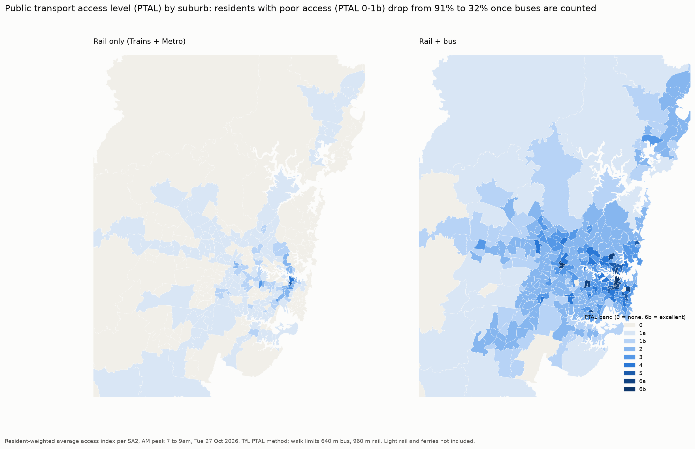

# Sydney Public Transport: Who Gets Let Down?

An end-to-end data project on live Transport for NSW open data, asking one planning question:

> **Where does Sydney's public transport let the most people down, and why?**

The focus is the rail network (Sydney Trains and Metro), with buses added wherever access is measured, because rail alone overstates the gaps. It combines the realtime train feed, the rail and bus timetables, Opal patronage, the Census, weather and OpenStreetMap to look at three things:

| Part | Question | Status |
| --- | --- | --- |
| Service equity | Which areas get the least public transport per resident, and who lives there? | Findings (rail and rail + bus) |
| Demand vs supply | Where do many people rely on thin or unreliable service? | First findings |
| Reliability and disruption | How late are trains, where, and what (including weather) makes it worse? | Collecting data; pipeline built |

Scope: Sydney Trains and Sydney Metro, plus the NSW TrainLink intercity lines that serve Greater Sydney. The bus timetable is included for access analysis (rail only vs rail + bus, using TfL's PTAL method), but reliability is rail only. Light rail and ferries are out of scope for now.

## Executive summary

Once buses are counted alongside trains and Metro, about **one in three Greater Sydney residents (32%) has poor public transport access**, on Transport for London's PTAL measure. The problem is concentrated where disadvantage and poor access overlap: **17 suburbs with about 257,000 people**, mostly in Campbelltown, Mount Druitt, parts of Bankstown and the Wyong lakes. Five standard access methods all point to the same places.

Rail alone reaches far fewer people: only 34% live within a 1.5 km walk of a station. **Almost half of the growth projected to 2041 is heading to suburbs without good rail access**, so the gap will widen unless service follows growth.

**Interactive dashboard:** `streamlit run app/streamlit_app.py` (see [Dashboard](#dashboard)). Full write-ups: the visual gallery and reports linked in [Reports](#reports).

## Findings



**Access (timetable, weekday AM peak, rail + bus unless stated)**

| Measure | Rail only | Rail + bus |
| --- | --- | --- |
| Residents with poor access (PTAL 0 to 1b) | 92% | 32% |
| Transport-disadvantaged suburbs (disadvantaged or car-poor, and poor access) | 57 suburbs, 906,000 people | 17 suburbs, 257,000 people |
| Jobs reachable within 45 min from 8am, average resident | 141,000 | 440,000 |
| Time from front door to boarding, Sydney average | 50 min | 17 min |

- **The worst-served disadvantaged suburbs** are Lethbridge Park - Tregear, Rosemeadow, Minto, Bradbury, Claymore, Leumeah and Macquarie Fields (Campbelltown), Colyton, Condell Park, Greenacre South, Blacktown South and the Wyong lakes (Blue Haven, Budgewoi, Toukley, Lake Munmorah).
- **Disadvantaged areas lose more outside commuter hours.** The average resident keeps 81% of their reachable jobs at 9pm and 75% on Sunday; the most disadvantaged suburbs keep 77% at 9pm, against 85% in the least disadvantaged.
- **Growth is outrunning rail.** 47% of TfNSW's projected growth to 2041 falls in suburbs where fewer than half of residents are near a station. Box Hill and Marsden Park have already doubled since 2021.
- **Walking distance matters.** Along real footpaths, the walk to a station is typically 28% longer than the straight line, and up to 1.8 times longer at stations such as Erskineville and Valley Heights.

**Demand (Opal)**

- **Busy stations, thin service.** Bondi Junction has about 131 morning-peak boardings per scheduled train, about twice most stations, as the rail-less eastern suburbs funnel through one terminus.
- **The Sydenham to Bankstown closure removed 5.8 million station entries a year,** and only about 3.1 million reappeared above trend at Sydenham. About 4.7 million aren't seen at any station: they're on replacement buses or no longer travelling by rail.
- **Metro gets the service and the riders.** The typical Metro station has 27 morning-peak trains an hour against 10 on Sydney Trains, and 2.7 times as many entries per nearby resident, with similar loads per train.

**Reliability (preview, one day of data)**

Delays are measured from train GPS positions. Early results show the method works: Central Coast trains ran 4 to 14 minutes late on the first day while suburban lines ran close to time. Full results (on-time rate by line and peak, passenger minutes lost, rain against delays) follow after a few weeks of collection.

## So what

Five evidence-based directions, cheapest first:

1. **More frequent buses in the 17 transport-disadvantaged suburbs.** They're mostly within reach of a bus already; frequency, not coverage, is the gap. In the slowest of them (Leumeah, Minto, Gorokan, Rosemeadow) it takes 19 to 23 minutes from the front door to board any service, against a Sydney average of 17, and they lose more access in the evening.
2. **New station entrances where the walk is much longer than it looks.** Erskineville, Valley Heights, Bella Vista, Birrong, Cheltenham and Turrella have walks 1.6 to 1.8 times the straight line. Entrances are cheap compared with new lines and widen catchments immediately.
3. **Rapid bus in the north-west and south-west growth areas before rail arrives.** Box Hill, Marsden Park, Austral and Leppington are growing fastest with no station in walking range.
4. **Plan the Bankstown transition around the riders who left.** Most of the 5.8 million yearly entries didn't move to another station; good replacement and feeder buses until Metro opens will decide whether they come back.
5. **Treat evening and weekend service as an equity issue.** Disadvantaged suburbs lose the most access outside commuter hours.

These are directions for further study, not costed proposals. Committed projects (Metro West, the Western Sydney Airport line, Bankstown Metro) aren't yet in the analysis and will change some of the gaps.

## How it works

```
TfNSW realtime feeds ─┐                                   ┌─► data/marts/  (tables)
  trip updates,        │   collectors        raw files     │
  alerts, positions    ├─► (Python, ───────► data/raw/ ───► analysis/ ───► outputs/figures/
TfNSW timetable        │   Task Scheduler)   untouched,    │                (charts, maps)
BOM weather + radar    │                     compressed    │
Park&Ride car parks ───┘                                   └─► reports
Opal, ABS Census, SEIFA, population, TZP24, OpenStreetMap  (one-off / monthly downloads)
```

**Collection.** Python collectors run on a schedule and save every raw response untouched, so everything can be replayed later.

| Data | Script | Frequency |
| --- | --- | --- |
| Realtime trip updates, alerts and vehicle positions (Trains + Metro) | `collect_realtime.py` | Every 30 s |
| Static GTFS timetable, one dated version per change | `pull_static.py` | Daily |
| Compaction of each finished day into one `.tar.xz` (about 30x smaller than raw) | `compact_raw.py` | Daily |
| BOM station observations and Open-Meteo hourly weather at every station | `pull_weather.py` | Every 6 h |
| BOM rain radar (about 0.5 km, every 5 min) | `pull_radar.py` | Every 30 min |
| Park&Ride car park occupancy | `pull_carpark.py` | Every 15 min |
| Opal patronage | `download_patronage.py` | Monthly |
| Census, SEIFA, population estimates and forecasts, station entrances | `download_census.py`, `download_context.py` | Once |

**Analysis** (`analysis/`), each step writing a table to `data/marts/`:

| Module | What it produces |
| --- | --- |
| `station_service.py` | Scheduled departures per station and time band for a service date |
| `service_equity.py` | Walkable service for every Census mesh block, summarised by suburb (SA2) and district (SA3) |
| `walk_access.py` | Walking distance along OpenStreetMap paths to the nearest station entrance |
| `equity_context.py` | Disadvantage (SEIFA), households without a car, 2025 population and 2041 forecasts per suburb |
| `demand_supply.py` | Morning-peak boardings per scheduled train, by station |
| `catchment.py` | Station entries per resident within walking distance |
| `access_index.py` | PTAL access index for every mesh block, rail only vs rail + bus |
| `jobs_access.py` | Suburb-to-suburb travel times (connection scan, numba) and jobs within 45 minutes |
| `pois.py` | Hospitals, tertiary campuses and supermarkets from OpenStreetMap |
| `opportunity_access.py` | Cumulative, gravity, time-of-day and transit gap measures; access vs unemployment |
| `reliability.py` | One observed delay per train per stop, from GPS positions with predictions as fallback |
| `passenger_minutes.py` | Delay weighted by how many people use each station |
| `excess_wait.py` | Excess wait time on frequent platforms (TfL method) |
| `opal_report.py`, `plot_equity.py`, `visuals.py` | Charts and maps in `outputs/figures/` |
| `export_dashboard.py` | Small precomputed tables for the dashboard in `app/data/` |

## Design decisions worth knowing

Full reasoning is in [DECISIONS.md](DECISIONS.md). The main ones:

- **Measured, not predicted, delays.** The realtime feed gives predictions, and over half of Sydney Trains' predictions read exactly 0. Each train's time at each station is therefore taken from its GPS position (recorded every 30 s), with the last prediction as a fallback.
- **Timetable versions matter.** Sydney Trains trip IDs change daily, so each realtime record joins to the timetable version in force on its service date. Every version is kept.
- **Sydney Trains leaves `start_date` blank.** The service date is the Sydney date three hours before the snapshot, because services run until about 3am.
- **Times are stored in UTC** and converted to Sydney time only for reporting, to avoid daylight saving errors.
- **The Metro timetable must come from the v2 endpoint.** The v1 feed stopped updating in 2024 and doesn't match the realtime trip IDs.
- **On time means less than 5 minutes late.**

## Running it

Windows and PowerShell, Python 3.13.

```powershell
python -m venv .venv
.venv\Scripts\Activate.ps1
pip install -r requirements.txt
```

Create a `.env` file in the project folder with your Open Data Hub key (register at [opendata.transport.nsw.gov.au](https://opendata.transport.nsw.gov.au)):

```
TFNSW_API_KEY=your-key-here
```

Start the scheduled collectors (Windows Task Scheduler, runs as you, no admin needed):

```powershell
powershell -ExecutionPolicy Bypass -File .\scheduling\register_tasks.ps1
Start-ScheduledTask -TaskName "SydneyTransit-CollectRealtime"
```

Download the reference data and run the analysis:

```powershell
python download_census.py
python download_context.py
python download_patronage.py
python -m analysis.station_service --date 2026-10-27
python -m analysis.service_equity
python -m analysis.equity_context
python -m analysis.demand_supply --date 2026-10-27
python -m analysis.catchment
python -m analysis.reliability
python -m analysis.passenger_minutes
python -m analysis.opal_report
python -m analysis.plot_equity
python pull_static.py --feeds buses
python -m analysis.walk_access
python -m analysis.access_index --date 2026-10-27
python -m analysis.jobs_access --date 2026-10-27
python -m analysis.equity_context
python -m analysis.pois
python -m analysis.opportunity_access
python -m analysis.excess_wait
python -m analysis.visuals
python -m analysis.export_dashboard
```

The walking-distance and destination steps need the OpenStreetMap Australia extract (about 1 GB) first. See the docstring in `analysis/walk_access.py`.

## Dashboard

An interactive Streamlit dashboard of the findings lives in `app/`. It reads only small precomputed files in `app/data/` (committed to the repo), so it runs without the raw data or an API key.

```powershell
pip install -r app/requirements.txt
streamlit run app/streamlit_app.py
```

It can be deployed free on Streamlit Community Cloud from the public GitHub repo (main file: `app/streamlit_app.py`).

## Reports

- Visual gallery: all charts and maps with commentary (`outputs/figures/`, `v01` to `v22`)
- Service equity report, Opal demand vs supply report and README review are kept as shared documents alongside the project.

[docs/DATA_COLLECTION.md](docs/DATA_COLLECTION.md) covers where every file lands, storage, compression and how to check the scheduled tasks.

## Roadmap

- [x] Realtime, timetable, weather, radar and car park collection
- [x] Service equity with disadvantage, car ownership, population growth and real walking distances
- [x] Demand vs supply from Opal patronage
- [x] Reliability pipeline using GPS-measured delays
- [ ] Move collection to a cloud VM (Docker, Terraform, Google Cloud Storage) so it doesn't depend on a laptop
- [ ] BigQuery warehouse and dbt models (staging, intermediate, marts) with tests
- [ ] Reliability report: on-time rate by line and peak, passenger minutes lost, rain and heat against delays
- [ ] Disruption causes: classify alert text with NLP and link causes to delays
- [x] Access to jobs and services by rail + bus (PTAL, cumulative, gravity, time-of-day, transit gap)
- [x] Interactive Streamlit dashboard
- [ ] Power BI version (semantic model, DAX)

## Data sources and licences

- Transport for NSW Open Data: GTFS and GTFS-realtime, Opal patronage, TZP24 projections, station entrances, car park API ([CC BY 4.0](https://opendata.transport.nsw.gov.au))
- Australian Bureau of Statistics: 2021 Census DataPacks, mesh block counts, ASGS boundaries, SEIFA 2021, estimated resident population (CC BY 4.0)
- Bureau of Meteorology: weather observations and rain radar ([terms](http://www.bom.gov.au/other/copyright.shtml))
- Open-Meteo: hourly weather (CC BY 4.0)
- OpenStreetMap contributors: walking network (ODbL)

Raw and derived data are not committed (see `.gitignore`); every dataset can be re-downloaded with the scripts above.
