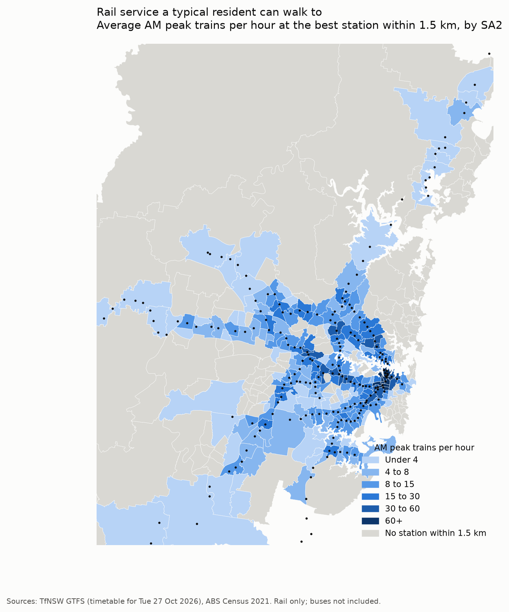
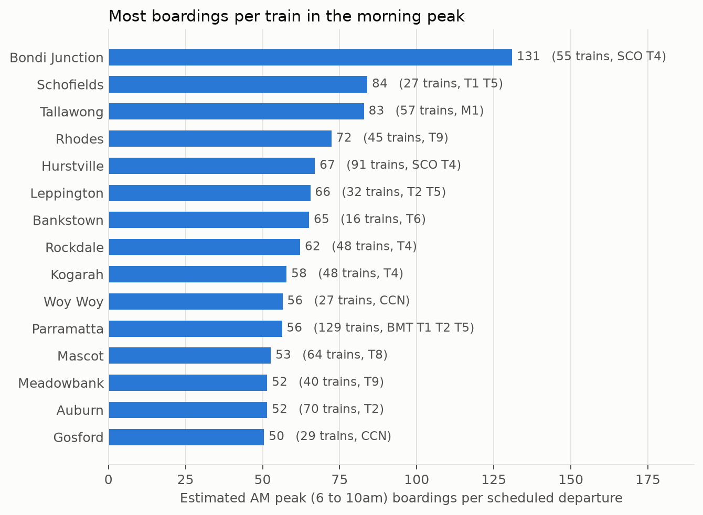

# Sydney Rail: Who Gets Let Down?

An end-to-end data project on live Transport for NSW open data, asking one planning question:

> **Where does Sydney's rail network let the most people down, and why?**

It combines the realtime train feed, the timetable, Opal patronage, the Census, weather and OpenStreetMap to look at three things:

| Part | Question | Status |
| --- | --- | --- |
| Service equity | Which areas get the least rail service per resident, and who lives there? | First findings |
| Demand vs supply | Where do many people rely on thin or unreliable service? | First findings |
| Reliability and disruption | How late are trains, where, and what (including weather) makes it worse? | Collecting data; pipeline built |

Scope: Sydney Trains and Sydney Metro, plus the NSW TrainLink intercity lines that serve Greater Sydney. Buses, light rail and ferries are out of scope for now.

## Findings so far



- **Only about a third of Greater Sydney lives within walking distance of rail.** Measured along real footpaths to station entrances, 34% of residents are within 1.5 km of a station and 16% within 800 m. Straight-line distance overstates this (45% and 24%).
- **Rail service is very unevenly shared.** The Gini coefficient of walkable train departures across residents is 0.75. Suburbs near Central can walk to over 140 trains an hour in the morning peak.
- **Disadvantaged areas are as close to rail as anywhere else, but get thinner service.** The most disadvantaged tenth of residents (SEIFA IRSD decile 1) can walk to about 7 morning-peak trains an hour, against 12 to 17 for most other deciles. 57 suburbs, home to about 906,000 people, are both disadvantaged or car-poor and poorly served by rail.
- **Almost half of Sydney's growth is heading to areas without rail.** 47% of the population growth TfNSW projects to 2041 falls in suburbs where fewer than half of residents are near a station. Box Hill and Marsden Park have already doubled since 2021.
- **Busy stations, thin service.** Bondi Junction has about 131 morning-peak boardings per scheduled train, about twice most stations, because it funnels the rail-less eastern suburbs through one terminus.
- **The Sydenham to Bankstown closure removed 5.8 million station entries a year,** but nearby stations gained only about 1.1 million above normal network growth. Most former riders are on replacement buses or have stopped using rail.



Reliability results (on-time rate, passenger minutes lost, weather effects) need a few weeks of collected data and will follow.

## How it works

```
TfNSW realtime feeds ─┐                                   ┌─► data/marts/  (tables)
  trip updates,        │   collectors        raw files     │
  alerts, positions    ├─► (Python, ───────► data/raw/ ───► analysis/ ───► outputs/figures/
TfNSW timetable        │   Task Scheduler)   untouched,    │                (charts, maps)
BOM weather + radar    │                     compressed    │
Park&Ride car parks ───┘                                   └─► reports
Opal, ABS Census, SEIFA, population, TZP24, OpenStreetMap  (one-off / monthly downloads)
```

**Collection.** Python collectors run on a schedule and save every raw response untouched, so everything can be replayed later.

| Data | Script | Frequency |
| --- | --- | --- |
| Realtime trip updates, alerts and vehicle positions (Trains + Metro) | `collect_realtime.py` | Every 30 s |
| Static GTFS timetable, one dated version per change | `pull_static.py` | Daily |
| Compaction of each finished day into one `.tar.xz` (about 30x smaller than raw) | `compact_raw.py` | Daily |
| BOM station observations and Open-Meteo hourly weather at every station | `pull_weather.py` | Every 6 h |
| BOM rain radar (about 0.5 km, every 5 min) | `pull_radar.py` | Every 30 min |
| Park&Ride car park occupancy | `pull_carpark.py` | Every 15 min |
| Opal patronage | `download_patronage.py` | Monthly |
| Census, SEIFA, population estimates and forecasts, station entrances | `download_census.py`, `download_context.py` | Once |

**Analysis** (`analysis/`), each step writing a table to `data/marts/`:

| Module | What it produces |
| --- | --- |
| `station_service.py` | Scheduled departures per station and time band for a service date |
| `service_equity.py` | Walkable service for every Census mesh block, summarised by suburb (SA2) and district (SA3) |
| `walk_access.py` | Walking distance along OpenStreetMap paths to the nearest station entrance |
| `equity_context.py` | Disadvantage (SEIFA), households without a car, 2025 population and 2041 forecasts per suburb |
| `demand_supply.py` | Morning-peak boardings per scheduled train, by station |
| `catchment.py` | Station entries per resident within walking distance |
| `reliability.py` | One observed delay per train per stop, from GPS positions with predictions as fallback |
| `passenger_minutes.py` | Delay weighted by how many people use each station |
| `opal_report.py`, `plot_equity.py` | Charts in `outputs/figures/` |

## Design decisions worth knowing

Full reasoning is in [DECISIONS.md](DECISIONS.md). The main ones:

- **Measured, not predicted, delays.** The realtime feed gives predictions, and over half of Sydney Trains' predictions read exactly 0. Each train's time at each station is therefore taken from its GPS position (recorded every 30 s), with the last prediction as a fallback.
- **Timetable versions matter.** Sydney Trains trip IDs change daily, so each realtime record joins to the timetable version in force on its service date. Every version is kept.
- **Sydney Trains leaves `start_date` blank.** The service date is the Sydney date three hours before the snapshot, because services run until about 3am.
- **Times are stored in UTC** and converted to Sydney time only for reporting, to avoid daylight saving errors.
- **The Metro timetable must come from the v2 endpoint.** The v1 feed stopped updating in 2024 and doesn't match the realtime trip IDs.
- **On time means less than 5 minutes late.**

## Running it

Windows and PowerShell, Python 3.13.

```powershell
python -m venv .venv
.venv\Scripts\Activate.ps1
pip install -r requirements.txt
```

Create a `.env` file in the project folder with your Open Data Hub key (register at [opendata.transport.nsw.gov.au](https://opendata.transport.nsw.gov.au)):

```
TFNSW_API_KEY=your-key-here
```

Start the scheduled collectors (Windows Task Scheduler, runs as you, no admin needed):

```powershell
powershell -ExecutionPolicy Bypass -File .\scheduling\register_tasks.ps1
Start-ScheduledTask -TaskName "SydneyTransit-CollectRealtime"
```

Download the reference data and run the analysis:

```powershell
python download_census.py
python download_context.py
python download_patronage.py
python -m analysis.station_service --date 2026-10-27
python -m analysis.service_equity
python -m analysis.equity_context
python -m analysis.demand_supply --date 2026-10-27
python -m analysis.catchment
python -m analysis.reliability
python -m analysis.passenger_minutes
python -m analysis.opal_report
python -m analysis.plot_equity
```

The walking-distance step needs the OpenStreetMap Australia extract (about 1 GB) first. See the docstring in `analysis/walk_access.py`.

[docs/DATA_COLLECTION.md](docs/DATA_COLLECTION.md) covers where every file lands, storage, compression and how to check the scheduled tasks.

## Roadmap

- [x] Realtime, timetable, weather, radar and car park collection
- [x] Service equity with disadvantage, car ownership, population growth and real walking distances
- [x] Demand vs supply from Opal patronage
- [x] Reliability pipeline using GPS-measured delays
- [ ] Move collection to a cloud VM (Docker, Terraform, Google Cloud Storage) so it doesn't depend on a laptop
- [ ] BigQuery warehouse and dbt models (staging, intermediate, marts) with tests
- [ ] Reliability report: on-time rate by line and peak, passenger minutes lost, rain and heat against delays
- [ ] Disruption causes: classify alert text with NLP and link causes to delays
- [ ] Access to jobs by rail within 45 minutes
- [ ] Dashboards in Power BI and Streamlit

## Data sources and licences

- Transport for NSW Open Data: GTFS and GTFS-realtime, Opal patronage, TZP24 projections, station entrances, car park API ([CC BY 4.0](https://opendata.transport.nsw.gov.au))
- Australian Bureau of Statistics: 2021 Census DataPacks, mesh block counts, ASGS boundaries, SEIFA 2021, estimated resident population (CC BY 4.0)
- Bureau of Meteorology: weather observations and rain radar ([terms](http://www.bom.gov.au/other/copyright.shtml))
- Open-Meteo: hourly weather (CC BY 4.0)
- OpenStreetMap contributors: walking network (ODbL)

Raw and derived data are not committed (see `.gitignore`); every dataset can be re-downloaded with the scripts above.
